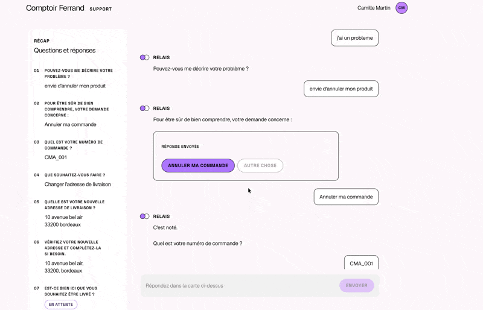

# Interactive Support

Interactive Support is a demo of a customer support for an online shop (completely mocked). A customer writes in to cancel an order or to report a damaged parcel, and the system understands the request, asks the right questions and acts on the order.

A good product is one that knows when not to use AI. This idea shows up more and more on social media, or at least in the places where I keep up with tech, and I fully agree with it: AI shouldn't be left to do too much, especially when it isn't useful.

The project comes from two frustrations. The first one is all the websites and forms that make me fill in information again, often information I had already given or that the site already had. The second one is the AI-powered chatbots that many sites have added and that, honestly, don't help much.

It also came at the same time as the release of [Jev](https://docs.typesafe.ai/models), the decision model I had already used in [Sentinel](../sentinel/README.md). Jev doesn't write anything: you ask it a closed question with described options, and it returns a probability for each one. With this kind of classification model, I could build a support with no context window limit, at a low cost, and that is still pleasant for the user.

The goal is to put AI where it is needed, and nowhere else. Each customer issue is a flow: a graph of typed steps, written and tested in advance. Most steps call no model at all: a choice, a form, reading an order. When a step really has to understand a free text or a photo, it makes one short call: to Jev to decide, or to a light LLM to split an address or write a short message. No call ever sees the whole history, and the memory is a typed object saved as JSON, so the cost of a turn doesn't grow with the conversation. A whole conversation makes 1 to 3 calls.

The flows themselves are meant to be written by a code agent, from a simple drawing of the journey. The expensive intelligence is paid once, when writing the flow, not at every message.

At first I wanted to go further, but this is a first, fairly simple version. It comes with a CLI, a REST API and a web interface to try it out. The next step would be to let the probabilities choose the interface: decide alone when the model is confident, ask for a confirmation or offer a choice when it isn't.

The design is described in much more detail in [docs/CONCEPTION.md](docs/CONCEPTION.md), and [SETUP.md](SETUP.md) explains how to run the project.

