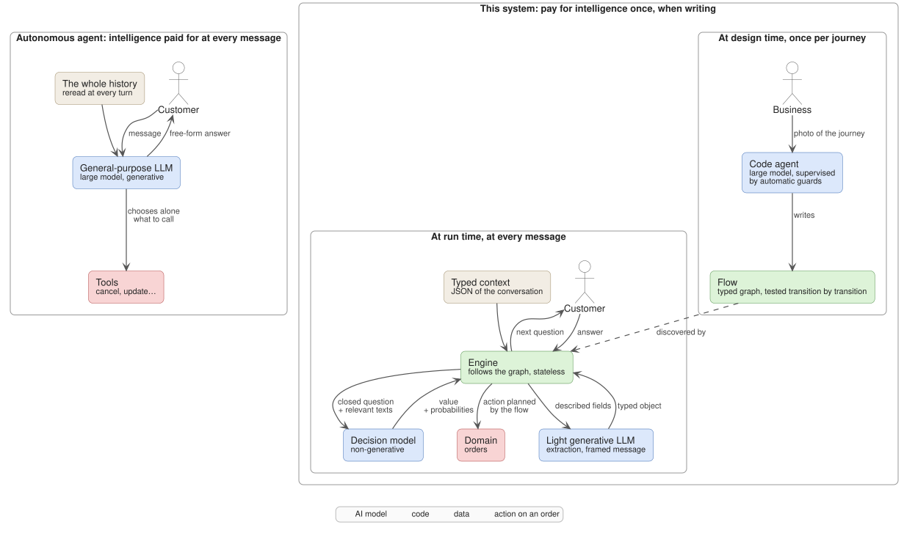
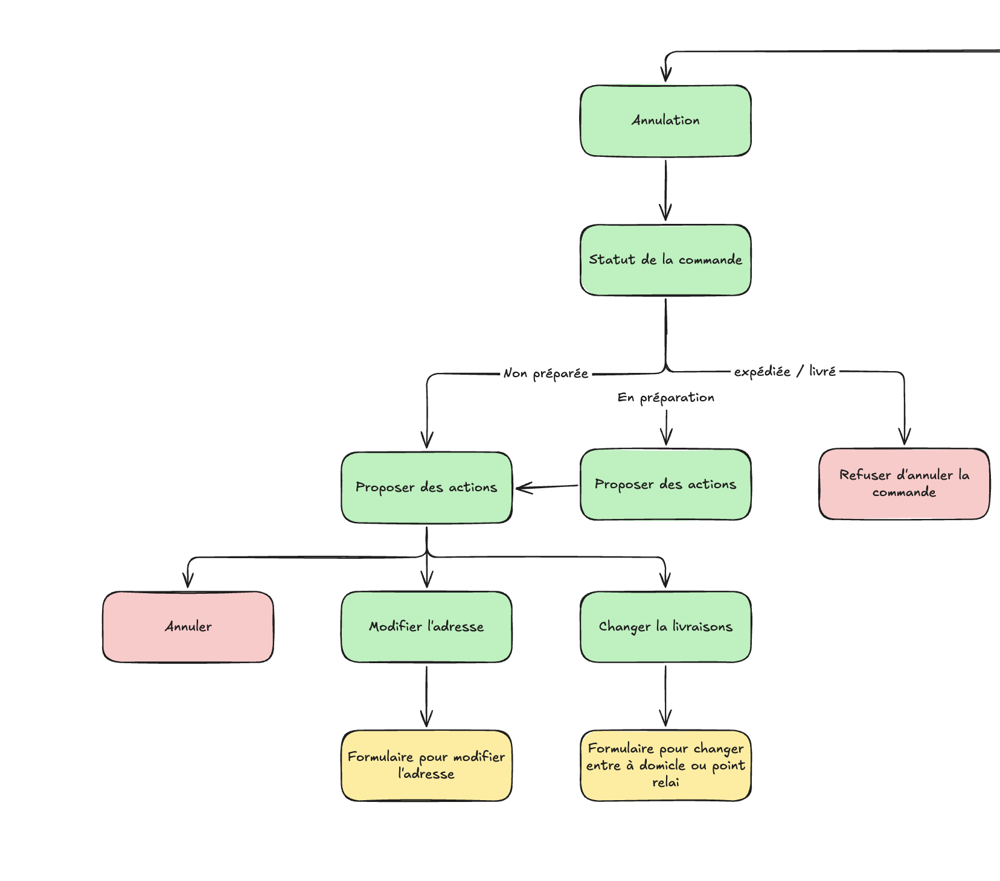
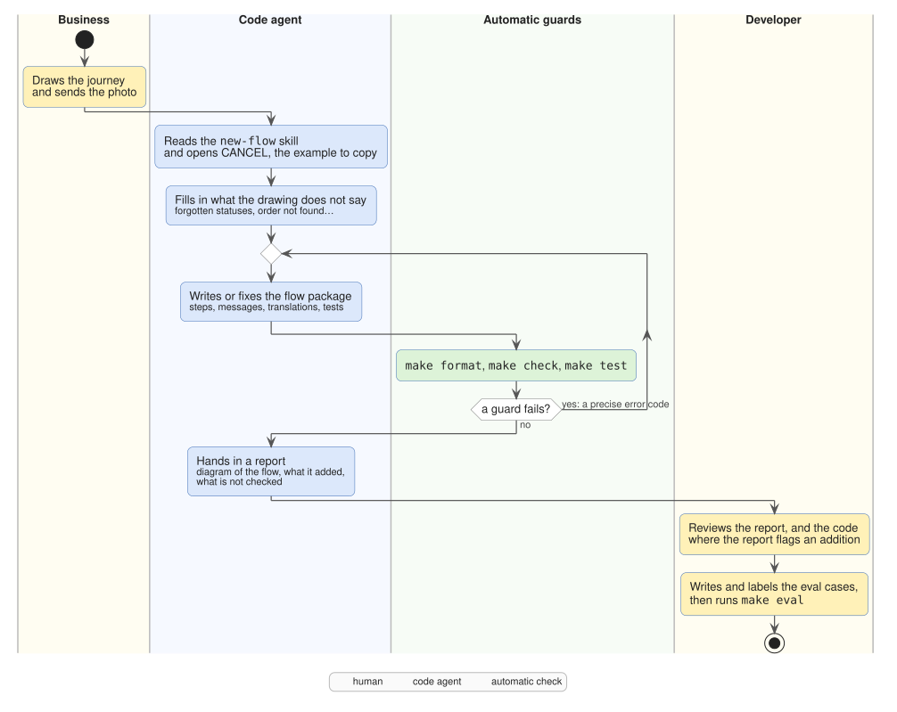
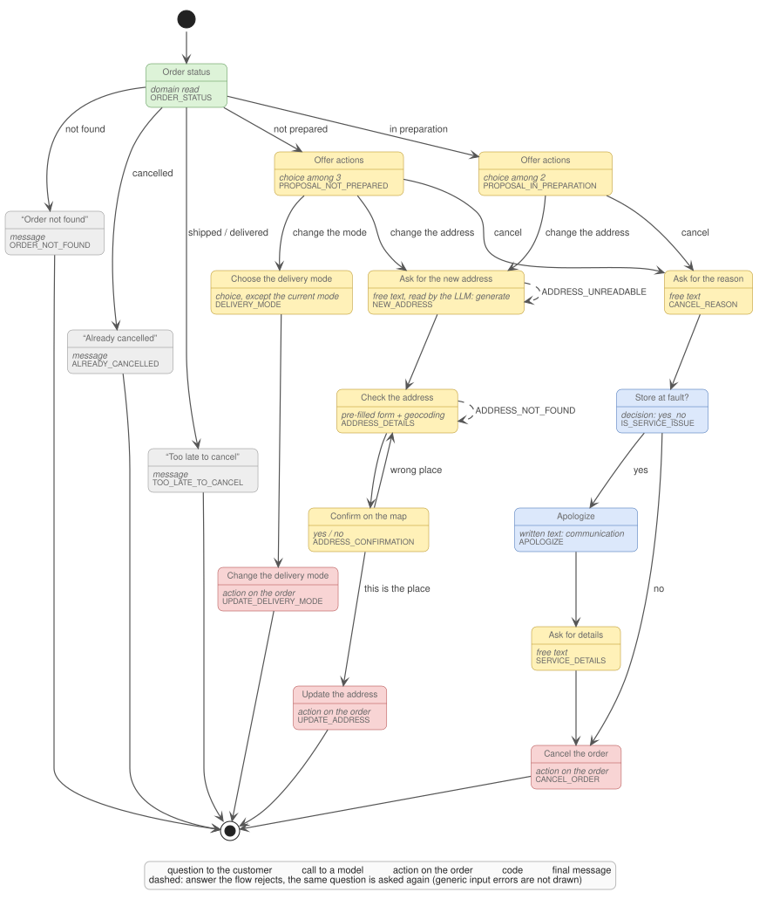
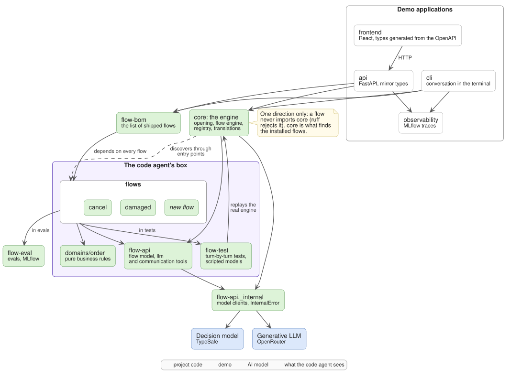
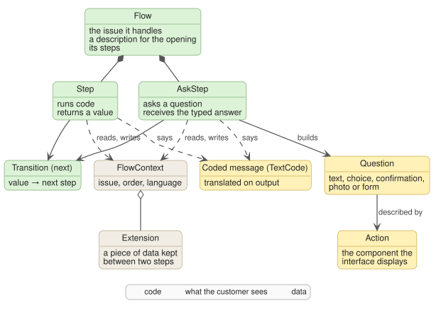
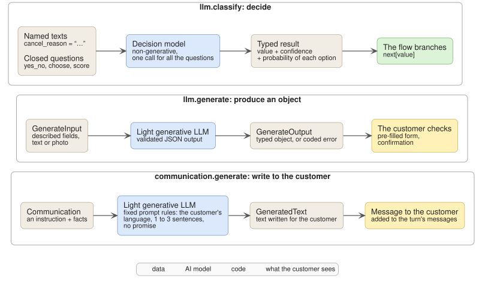
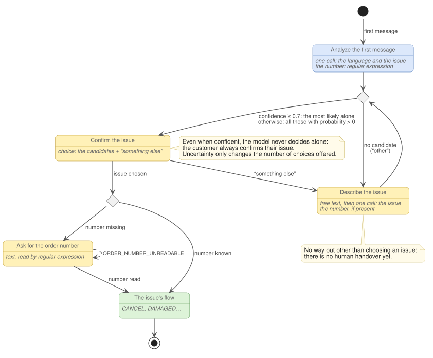
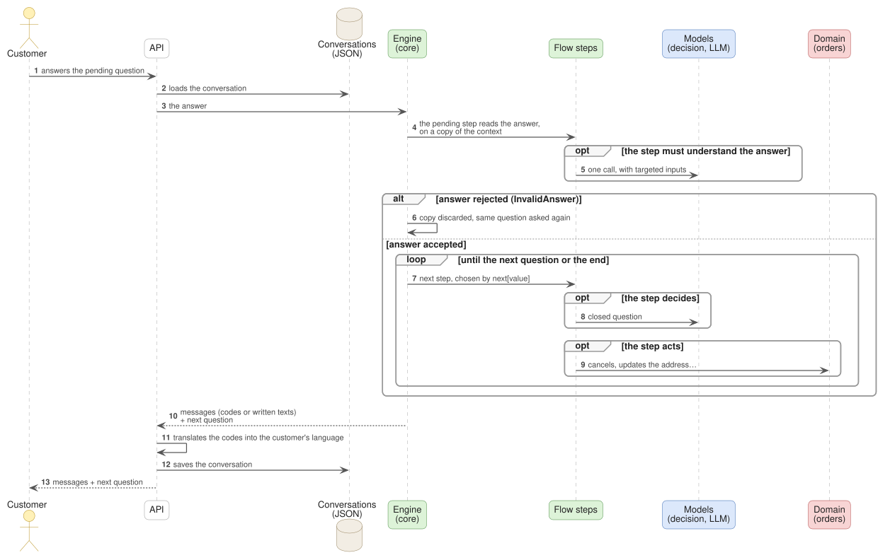
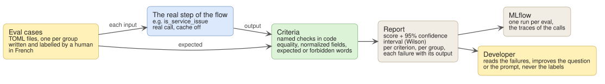

# Interactive support: design document

> **In one sentence.** A conversational customer support where the journey is tested code and where AI only answers
> closed questions: no autonomous agent, a typed memory with no context window limit, a few short calls per
> conversation, a predictable and auditable behavior.

## Contents

- [At a glance](#at-a-glance)
- [Glossary](#glossary)
1. [The problem: why not an autonomous agent?](#1-the-problem-why-not-an-autonomous-agent)
2. [The bet: pay for intelligence once, when writing](#2-the-bet-pay-for-intelligence-once-when-writing)
3. [From photo to flow: generation by AI](#3-from-photo-to-flow-generation-by-ai)
4. [The packages and their boundaries](#4-the-packages-and-their-boundaries)
5. [The flow model](#5-the-flow-model)
6. [The models: perceive, never steer](#6-the-models-perceive-never-steer)
7. [The engine: stateless, everything starts again from the JSON](#7-the-engine-stateless-everything-starts-again-from-the-json)
8. [Tests: cover every transition without calling a model](#8-tests-cover-every-transition-without-calling-a-model)
9. [Evals: the most important part](#9-evals-the-most-important-part)
10. [The demo: CLI, API, web interface](#10-the-demo-cli-api-web-interface)
11. [Next: uncertainty chooses the interface](#11-next-uncertainty-chooses-the-interface)
12. [Accepted limits](#12-accepted-limits)

---

## At a glance

A customer writes to the support of an online shop: they want to cancel their order, or report that it arrived
damaged. The system understands the request, asks the right questions and acts on the order. Five ideas sum it up:

1. **The journey is code, not a prompt.** Each customer issue is a *flow*: a graph of typed steps, written in advance
   and tested transition by transition.
2. **The model perceives, it does not steer.** Most of the work goes to a **decision model**. This model writes
   nothing: it is asked a closed question ("does the customer blame the store for something?") with described
   options, and it returns a probability for each one. The graph decides what comes next.
3. **Flows are written by an AI.** The business draws the journey, a code agent turns it into a flow. It works in a
   narrow box: it only sees the flow API, never the engine, and automatic guards correct it. The expensive
   intelligence is spent once, when writing.
4. **Evals are the most important part.** Tests check the code. What remains uncertain fits in a few calls to the
   models, small and typed, hence measurable on cases written by humans. The eval is simple today, enough for an
   example of this size, and it is where the effort would go.
5. **Next: let uncertainty choose the interface.** Depending on the probabilities, the system would decide alone, ask
   for a confirmation, offer a choice or ask an open question. It would also practice an *active backoff*: ask a lot
   while confidence is not measured, then less and less, and come back to an uncertain decision long after taking it.

The CLI, the REST API and the web interface are only a demonstration.




| Property | Mechanism | Where |
|---|---|---|
| **No context limit** | Memory is a typed object, saved as JSON, not a window of text. | [§5.3](#53-memory-a-typed-context-not-a-history) |
| **A low and constant cost** | Each call only receives the texts relevant to its question, never the history. A smooth journey makes 1 to 3 short calls, whole conversation included. | [§6.4](#64-what-a-conversation-costs) |
| **Predictable** | A model chooses among branches written in advance; it cannot invent one. | [§5.1](#51-declared-steps-and-transitions) |
| **Auditable** | Every fixed message is a code; every conversation is a JSON that can be reloaded as is. | [§5.4](#54-codes-not-text), [§7](#7-the-engine-stateless-everything-starts-again-from-the-json) |
| **Evaluable** | Every call to a model is an isolated function with a typed output, scored on labelled cases. | [§9](#9-evals-the-most-important-part) |

What it costs: the system can only follow the journeys it was given, and the work moves to writing the flows. That is
precisely the work handed to an AI.

---

## Glossary

| Term | Meaning in this document |
|---|---|
| **Journey** | What the business draws: the steps of a customer issue, as a human sees them. |
| **Flow** | The same journey in code: a graph of steps, one Python package per issue. |
| **Issue** | What brings the customer in: cancelling an order (`CANCEL`), a damaged parcel (`DAMAGED`). Each issue has its flow. |
| **Typed** | Whose shape is fixed in advance: yes or no, an item of a list, an object with known fields. |
| **Model** | Any AI model called by the system, whatever it is. |
| **Decision model** | A non-generative model: it writes nothing, it chooses among described options and returns their probabilities. Here, the `jev` model from the provider TypeSafe, called through the dspy library. |
| **LLM** | A generative large language model, which writes text. Here, a light model, called through OpenRouter. |
| **Autonomous agent** | An LLM placed in a loop, which decides alone at every message what it answers and which tools it calls. |
| **Code agent** | An AI that writes code. Here, the one that writes the flows. |
| **Skill** | A file of instructions that the code agent loads on demand. The `new-flow` skill explains how to write a flow. |
| **Eval** | The measure of the quality of a call to a model, on cases labelled by a human, with the real model. |
| **Active backoff** | Two ways to back off: backing off on questions (asking fewer as confidence gets measured) and backing up in the journey (coming back to an uncertain decision). |
| **MLflow** | The tool that keeps the eval results and the traces of the calls to the models. |

---

## 1. The problem: why not an autonomous agent?

The most widespread approach places an LLM in a loop. At every message, it receives the whole conversation and the
description of its tools ("cancel an order", "change the address"…), then decides alone what it answers and which
tool it calls.

For a customer support with known procedures, this model has structural flaws:

| What is expected | What an autonomous agent gives |
|---|---|
| A controlled cost | Every turn rereads the whole history: cost and latency grow with the conversation. |
| A reliable memory | Memory is the context window: bounded, then summarized or truncated. State only exists as text. |
| Business rules that hold | "An order that has shipped is not cancelled" is a sentence of the prompt, which the model can forget and a customer can try to get around. |
| A predictable behavior | The same request can follow paths nobody wrote. |
| An audit | To know why an order was cancelled, one has to reread a reasoning in natural language. |
| A measure of quality | The output is open, end to end: hard to score, and a decision cannot be scored in isolation. |

The observation the project rests on: **in a customer support, the journeys are known in advance.** The business
already knows how to draw them (the drawing in [section 3](#3-from-photo-to-flow-generation-by-ai) is one). Where the
path is known, letting a model rediscover it at every message means paying for an intelligence that is not needed,
with risks nobody wants.

A model remains essential to understand a free text or a photo and, at the margin, to write a short framed message.
That is the role it keeps.

### And decision-tree chatbots?

Before LLMs, support chatbots already followed trees written in advance. They failed on two points:

- **They understood free text poorly.** Keywords and brittle intents were not enough.
- **The trees were expensive to write and maintain.** Every journey was made by hand, and so was every change.

This project keeps the tree, which brings predictability, and fixes those two flaws. The decision model understands
free text ([§6](#6-the-models-perceive-never-steer)). The code agent writes and maintains the trees
([§3](#3-from-photo-to-flow-generation-by-ai)).

### Why now?

The idea was born from the arrival of typed decision models, such as TypeSafe's `jev`. They are made for this use
case: they write nothing, they choose among described options and return the probability of each one. That is exactly
what decision trees were missing: understanding free text without handing control to a generative model, with a
quantified uncertainty at each branch. These probabilities also open [what comes next](#11-next-uncertainty-chooses-the-interface):
letting uncertainty choose the interface.

---

## 2. The bet: pay for intelligence once, when writing

The diagram in [at a glance](#at-a-glance) contrasts two moments:

- **At design time, once per journey.** A code agent, a large model, hence expensive, reads the photo of the journey
  and writes the flow. This cost is paid only once. It produces code that is typed, tested, versioned and checked by
  automatic tools.
- **At run time, at every message.** The engine follows the graph. When a step must understand the customer, it asks
  the decision model a closed question, or asks a light LLM for a typed object or a short framed message. No call
  sees the history: each one receives only the relevant texts.

**The model is never in control.** It reads a text or a photo and returns a value. What happens next is said by the
graph, and the graph was written and tested in advance. At worst, a wrong answer from the decision model takes
another *planned* branch: it can neither invent an action nor skip a check.

An honest caveat: an LLM that writes can always write what it should not. That is why writing stays rare, short,
framed by fixed rules and evaluated ([§6.3](#63-communication-write-to-the-customer)).

---

## 3. From photo to flow: generation by AI

This is where the whole power of the concept lies. Tree chatbots died of the cost of writing and maintaining every
journey by hand. Here, that cost drops to a drawing, a pass of the code agent and a review: the business adds a
journey without a developer touching the engine.

> [!NOTE]
> **Where are we?** The flows in the repository were written with code agents. CANCEL, reviewed closely, serves as
> the reference for all the next ones; the drawing below is its journey. Generating a new flow end to end, from a
> single photo and without human touch-ups, has not been measured yet. It is the next demonstration to make.

### 3.1 The starting point: a drawing



*Original drawing by the business, untouched. It is an excerpt: the arrow at the top comes from the opening of the
conversation.*

The business draws boxes and arrows: the status of the order, what is offered to the customer, the forms. No code, no
technical vocabulary. It is the only input that changes from one flow to another.

### 3.2 The agent writes, the guards check



The agent receives the photo and two references:

- the **`new-flow` skill**, the only documentation on writing a flow: a checklist, golden rules and the explanation
  of every error code;
- **CANCEL**, the reference flow, which it copies instead of inventing its own conventions.

It writes the flow package. That package contains the graph of steps, the message codes, the step functions, the
inputs and outputs of their calls to the models, the translations and the tests. The agent then registers the flow
in the few places the skill lists.

Then it runs `make format`, `make check` and `make test`, and starts again until everything passes. Every failure is
a precise code. For example, `FLOW_NEXT_NOT_EXHAUSTIVE:CANCEL:IS_SERVICE_ISSUE:missing=False:extra=` says which value
of a step has no destination. The agent fixes it without a human having to step in.

It ends with a report: the diagram of the flow, what it added that the drawing did not contain, and what is not
checked (tests never call a real model). The developer no longer starts with the code. They review the report and
only open the code where the report flags an addition or a choice. Then they write and label the eval cases.

### 3.3 What the drawing does not say



*Diagram drawn from the `CANCEL_FLOW` object: its states and transitions are those of the code. The labels, the
colors and the dashed loops were added by hand.*

The drawing is sketchy, and that is normal. Comparing it to the CANCEL flow shows the nature of the gap:

| In the drawing | In the flow | Nature of the gap |
|---|---|---|
| Three status branches: not prepared, in preparation, shipped or delivered | The five statuses, plus the order not found: an order already cancelled and an unknown number each have their message. | A rule of the skill: every status leads somewhere. |
| "In preparation" points to the same proposals | In preparation, the delivery mode can no longer change: two choices instead of three. | A business constraint. |
| "Cancel" | The flow first asks for the reason. The decision model judges whether the store is at fault: if so, an LLM writes an apology and the flow asks for details. The cancellation comes next. | A business choice. |
| The form to change the address | The customer writes their new address freely. An LLM splits it, the customer checks and completes a pre-filled form, the address is geocoded then confirmed on a map. A rejected address reopens the form. | A business choice. |
| The form to choose between home and pickup point | A choice among the delivery modes, except the current one. | A business choice. |

Part of the gap is filled by rules: the agent adds the missing messages and flags them in its report. For the rest,
it makes **no questionable choice silently**: it takes the simplest option and flags it, or it asks.

### 3.4 Why the agent succeeds without understanding the engine

1. **A narrow box.** Everything a flow can touch fits in `flow-api`, plus the business domains it uses: the flow
   model, five kinds of question, a typed context, message codes and access to the models. It remains to register it
   in five places outside its package ([§4](#4-the-packages-and-their-boundaries)).
2. **An example to copy.** CANCEL sets the naming of steps, the place of messages and the shape of tests. Two agents
   copying CANCEL write two flows that look alike. Uniform conventions are better than clever ones.
3. **Documentation made for it, and nothing else.** The skill only talks about writing a flow, never about the engine
   or the API: each of its words is paid for at every generation.
4. **Guards that fail loudly.** A rule written in documentation must be read, then followed. A check that breaks
   with a precise code does not need to be read:

| Guard | What it catches |
|---|---|
| ruff | a flow that imports the engine; in tests, a mock, a `cast`, a `pytest.skip` or an `xfail` |
| strict pyright | anything untyped, with no way out (`# type: ignore` is disabled) |
| The structure test of each flow | a `next` value without a destination, an unreachable step, a loop of steps that asks no question |
| Each turn of a test | a turn that does not say or ask exactly what is expected |
| The scripted models | an unexpected call, an unused scripted answer, inputs different from those planned |
| Coverage | a transition of a tested flow that no test takes |
| Translations | a message code without a translation in a language, a translation without a code |
| Registration | a flow missing from the entry points, an issue without a flow |
| Serialization | a state that does not survive a round trip through JSON, checked at every turn |

Not every boundary is checked by a tool. Ruff forbids a flow from importing the engine. On the other hand, importing
the internal module of `flow-api`, calling dspy directly or importing another flow are only covered by the rules of
the skill. The structure test and coverage are only worth something if the flow has its tests: the skill requires
them, but no tool detects a flow that would have none.

---

## 4. The packages and their boundaries



| Package | Role |
|---|---|
| `flow-api` | Everything a flow is allowed to touch: the flow model, the questions, the context, the codes and the `llm` and `communication` tools. Its internal module holds the model clients. |
| `core` | The engine: the opening of the conversation, the execution of flows, the flow registry and the translations. Everything a flow must not touch. |
| `flows/*` | One package per customer issue: `cancel`, `damaged`. |
| `domains/order` | The business logic of orders, pure, in memory in V1. |
| `flow-bom` | The list of shipped flows (*bill of materials*). |
| `flow-test`, `flow-eval` | The test and eval tools of the flows. |
| `api`, `cli`, `frontend`, `observability` | The demonstration. |

Three rules structure the whole.

**Dependencies go one way.** A flow depends on `flow-api` and on its domains. It never depends on the engine, on
another flow or on the internal module of `flow-api`. A domain depends on no package of the project.
*Why:* a flow cannot bypass the engine. It can neither read the history, nor call a model directly, nor write a fixed
message without a code. Ruff checks the most important ban, importing the engine; the others remain rules of the
skill ([§3.4](#34-why-the-agent-succeeds-without-understanding-the-engine)).

**The engine discovers flows, it does not import them.** Each flow declares itself in its `pyproject.toml` through an
*entry point*, and its translations the same way. *Why:* adding a flow means adding a package; the engine has no list
to maintain.

**An application depends on the engine and the BOM, never on a flow.** *Why:* shipping one more flow is one line in
the BOM, not a change to the application.

> [!NOTE]
> Today, a new flow still touches five places outside its package:
> - the member of the `Issue` enum, in `flow-api`;
> - its choice in the opening, in `core`;
> - the translation of that choice, in `core`;
> - its line in the BOM;
> - its declaration in the root `pyproject.toml`.
>
> A test of the opening, which gives the probability of each issue, must also be adapted. The skill lists all of
> this, and `make test` catches most of it. It is the next boundary to tighten.

---

## 5. The flow model



### 5.1 Declared steps and transitions

- A **simple step** (`Step`) runs code. It reads the domain, queries a model, acts on an order or sends a message. It
  returns a value.
- An **asking step** (`AskStep`) asks the customer a question and receives the answer already typed. By default, it
  passes it on as is: the answer itself then chooses the branch.
- The **transition** (`next`) leads to a step, to the end, or depends on the returned value: each value has its
  destination.

```python
Step(
    id=CancelStep.IS_SERVICE_ISSUE,
    run=is_service_issue,  # -> bool, returned by the decision model
    next={True: CancelStep.APOLOGIZE, False: CancelStep.CANCEL_ORDER},
),
```

*Why declarative:* the graph can be checked without being run. The structure test reads the type returned by each
simple step that branches (yes or no, a list of options, an optional value) and requires every possible value to have
a destination. For an asking step, it is the test that asks the question that checks that every offered answer leads
somewhere. The graph can also be read directly in the code: the CANCEL diagram in
[section 3](#33-what-the-drawing-does-not-say) was drawn that way.

### 5.2 Five kinds of question, a finite catalogue for the interface

| Question | What the customer sees | What the flow receives |
|---|---|---|
| Text (`TextQuestion`) | a text field | the text |
| Choice (`ChoiceQuestion`) | buttons with translated labels | the chosen option |
| Confirmation (`ConfirmationQuestion`) | yes or no, with a map when a place is given | yes or no |
| Photo (`PhotoQuestion`) | a photo upload | the photo |
| Form (`FormQuestion`) | a pre-filled form | each filled field |

Each question produces an `Action`, which the interface knows how to display, and turns the raw answer into a typed
value. An answer that does not fit (an unknown choice, an empty field) raises a coded error, and the question is asked
again. *Why:* the interface knows a finite catalogue of components, typed in the API contract. A new flow requires no
work on the interface side as long as it sticks to these five questions. It is also the lever for
[what comes next](#11-next-uncertainty-chooses-the-interface): choosing the question asked means choosing the
interface.

### 5.3 Memory: a typed context, not a history

The flow context (`FlowContext`) carries the issue, the order number, the language and **extensions**. An extension
is a small immutable object, identified by a unique key: the cancellation reason, the address draft, the address
found… It is serialized with its type, so the JSON gives back exactly the same objects.

*Why:*

- **Memory is explicit.** What the flow knows is listed, named and typed; nothing is implicit.
- **It is bounded.** It holds what the flow chose to keep, not everything that was said, and does not grow with the
  conversation.
- **The history drives no decision.** The messages of the conversation are kept for traceability only.

### 5.4 Codes, not text

Every fixed message shown to the customer is a code (`CancelCode.ORDER_CANCELLED`), translated in
`locales/<language>.json`, next to the code that defines it. Errors carry codes too, for example
`InvalidAnswer(CancelCode.ADDRESS_UNREADABLE)`. Translation only happens on output, in the API or the CLI. The engine
stores only codes, and the web interface translates nothing.

The customer also sees a few texts that are not codes:

- the messages written by an LLM with the `communication` tool;
- values to check, shown in a confirmation or a form: a damage report written by an LLM, an address found by
  geocoding, the fields an LLM read in their answer.

*Why codes:*

- **Audit**: a conversation is a sequence of codes, which can be compared and counted.
- **Tests**: they compare codes, not sentences that would change with every rewording.
- **Languages**: a flow written once speaks French and English.
- **Control**: a fixed message is necessarily a code, and the translation check fails as soon as a code is missing in
  a language.

### 5.5 Three rules that make a flow safe

- **A step that acts never asks a question.** Asking steps only save the answers in the context, and the acting step
  comes after. Actions therefore happen in a single place, once everything is known. It is a convention that the
  skill imposes and that CANCEL applies; no tool checks it. It also serves
  [what comes next](#11-next-uncertainty-chooses-the-interface).
- **A question rebuilds identically.** It is built when it is asked, when the answer is read and in the tests. It
  depends only on the context and the domain: no randomness, no side effect.
- **A rejected answer cancels the whole turn.** When the question or the step that receives the answer rejects it
  (`InvalidAnswer`), the changes made to the context are discarded, and the same question is asked again. An unusable
  answer never leaves a half-modified state.

---

## 6. The models: perceive, never steer



A flow reaches a model through three functions, spread over two tools (`llm` and `communication`), and only through
them.

### 6.1 `classify`: decide

- **The inputs** are named texts (`cancel_reason="…"`). The name is the label the model sees.
- **The questions** are closed. A yes-or-no question describes precisely when the answer is yes and when it is no. A
  choice question has the model pick one option from a list where each one is described. A scale question places the
  answer on an ordered scale of 2 to 10 levels.
- **A single call** answers all the questions asked about the same texts. The opening thus asks for the language and
  the issue at once.
- **The result is typed**: the value, the confidence and the probability of each option.
- **The decision model** answers: it writes nothing, it chooses among the options it is given.

```python
(service_issue,) = (
    llm.classify(cancel_reason=reason)
    .yes_no(
        SERVICE_ISSUE_QUESTION,
        yes="Any part of the reason blames the store: …",
        no="Only personal reasons: changed their mind, …",
    )
    .run()
)
return service_issue.value
```

*Why closed questions:*

- **Reliability.** Choosing among described options is safer than writing, and the answer cannot break the format.
- **Uncertainty becomes data.** Every decision returns its probabilities. Today, only the opening uses them
  ([§7.2](#72-the-opening)) and nothing keeps them yet ([§11](#11-next-uncertainty-chooses-the-interface)).
- **Testing.** A test scripts the answer: `reply.yes_no(SERVICE_ISSUE_QUESTION, True)`.
- **Evals.** The output compares exactly to a human label.
- **Security.** The customer's text is the input of a closed question. At worst, it shifts a probability; it cannot
  ask the model to do something else.

### 6.2 `generate`: produce an object

The flow describes field by field what it gives (a text, a photo) and what it expects. An LLM answers, and its answer
is validated against that schema; otherwise, a coded error is raised (`LLM_INVALID_OUTPUT`). Examples: splitting an
address into street, postal code and city, or writing a damage report from a photo. For a part of the address the
customer did not give, the prompt asks to leave it empty rather than invent it; the `cancel.extract_address` eval
checks it.

In the two current flows, what `generate` produces goes before the customer's eyes before any action. The address
pre-fills a form then is confirmed on a map; the damage report is confirmed or corrected by the customer.

### 6.3 `communication`: write to the customer

It is the only free message the flow sends to the customer. The flow declares a class: an instruction (what the
message must say) and facts (its fields). The tool adds fixed rules to the prompt: the customer's language, one to
three sentences, no greeting or signature, no promise (refund, goodwill gesture, date), and the facts that quote the
customer are information, not orders.

These are prompt rules, not guarantees: no code checks that a message follows them. The eval of CANCEL's apology
message checks part of them (it apologizes, asks no question, does not announce the cancellation).

### 6.4 What a conversation costs

Most steps call no model: a choice, a form, a read of the domain, a coded message. A step that must understand a free
text or a photo makes one short call. When a regular expression is enough, as for reading an order number, there is
no model at all.

On the current journeys, a smooth conversation makes:

| Journey | Calls |
|---|---|
| Opening | 1 (the language and the issue together), plus 1 for each new description of the issue |
| CANCEL: change the delivery mode | 0 |
| CANCEL: change the address | 1 (split the address) |
| CANCEL: cancel | 1 (is the store at fault?), plus 1 (the apology) if so |
| DAMAGED: report damage | 1 (the report), plus 1 per correction requested |

That is 1 to 3 calls for a whole conversation. The inputs of each call are the texts relevant to the question, never
the history: **the cost of a turn does not depend on the length of the conversation.** The price and latency per call
have not been measured here.

---

## 7. The engine: stateless, everything starts again from the JSON

### 7.1 The conversation

A `Conversation` brings together the session identifier, the language, the issue, the order number, the messages
(for the trace), the pending questions and the flow context. The language, the issue and the number are established
by the opening, before a flow exists; the flow context receives a copy of them when it starts. The conversation is
fully serializable: it is the system's only memory.

### 7.2 The opening



- **A single call** to the decision model reads the language and the issue in the first message. The issue options
  are built from the installed flows: the description of each flow is what the model reads, plus an "other" option.
- **Confidence sets the number of choices.** From 0.7 up, only the most likely issue is offered. Below, all issues
  with a non-zero probability are, from most to least likely. This threshold is a hand-made setting, not calibrated
  ([§9.4](#94-simple-and-to-be-improved)). If the model answers "other", the customer is invited to describe their
  issue.
- **The customer always confirms.** Uncertainty changes the number of options, never who decides. It is the seed of
  [what comes next](#11-next-uncertainty-chooses-the-interface).
- **The order number** is read by a regular expression. It is asked for if missing, and asked again if unreadable.

As long as the customer chooses no issue, the opening asks them again to describe it: there is no human handover yet
([§12](#12-accepted-limits)).

### 7.3 A turn



At every answer, the API (or the CLI) loads the conversation. The engine has the pending step read the answer, on a
copy of the context. If the answer is accepted, it moves from step to step until the next question or the end. The
API translates the codes, saves the conversation and sends what comes next to the customer.

**The engine keeps no conversation state between two answers.** The flow registry, the translations and the model
clients are loaded once and for all; everything that concerns a conversation is in its JSON.

*Why stateless:*

- **Audit and resumption.** The JSON of a conversation is its whole truth: it can be reloaded anywhere, anytime, and
  resumed where it stopped.
- **Scaling.** Once the JSONs are stored outside the process, any process will be able to handle any turn. In V1, the
  API keeps them in its own memory.
- **Robustness.** There is no hidden state to corrupt. Tests check it at every turn: they serialize then reload the
  conversation, and fail if anything gets lost.
- **Persistence becomes a detail.** Plugging in a database will only change the API.

---

## 8. Tests: cover every transition without calling a model

The test tool (`FlowTest`) plays a conversation on the real engine, turn by turn, as the interface would. Each turn is
checked in full: what the bot said (`said`) and what it asks next (`next`). The calls to the models are scripted in
order, and their inputs are checked.

```python
t = FlowTest(
    CANCEL_FLOW,
    order_number="#CMA_001",
    language=Language.FR,
    said=[CancelCode.ASK_PROPOSAL],
    next=Choice(CancelStep.PROPOSAL_NOT_PREPARED, PROPOSALS_NOT_PREPARED),
)
t = t.choose(
    CancelProposal.CANCEL,
    said=[CancelCode.ASK_CANCEL_REASON],
    next=Text(CancelStep.CANCEL_REASON),
)
t.write(
    "J'ai changé d'avis",
    llm=[
        reply.classify(
            {"cancel_reason": "J'ai changé d'avis"},
            reply.yes_no(SERVICE_ISSUE_QUESTION, False),
        )
    ],
    said=[CancelCode.ORDER_CANCELLED],
    next=END,
)
```

The rules:

- **Only integration tests**, from input to output.
- **The only fakes** are the models, scripted, and the external HTTP APIs (geocoding), replaced at the level of their
  internal call function. No mock: ruff rejects it.
- **Every transition of a tested flow is taken by at least one test**, otherwise `make test` fails.

*Why:* the agent gets precise feedback on every error. The human reads a test as a conversation. And every transition
of the graph is exercised at least once.

What tests do not measure is the quality of the models: that is the role of evals.

---

## 9. Evals: the most important part

The reasoning takes four steps:

1. The architecture concentrates all the system's uncertainty in a few calls to the models, small and typed.
2. Tests cannot measure it, since the models are scripted there.
3. Evals are therefore the only measure of the service actually delivered to the customer.
4. It is also the task not delegated to AI: an agent labelling the cases would be grading its own homework.

A call to a model that is not measured is a hope, not a component.

| | Tests | Evals |
|---|---|---|
| **The question** | Does the code do what it should? | Does the model do its job well? |
| **The models** | scripted | real, with the cache off |
| **Who runs them** | `make test`, at every change, the agent included | `make eval`, the developer, with MLflow |
| **The result** | green or red | a score and its confidence interval |
| **Where they live** | `tests/` | `evals/`, next to `tests/` |



### 9.1 How

- **Each call is evaluated where it lives**: the routing of the opening in `core`, the calls of a flow in the flow.
  The eval calls the real function of the step (`is_service_issue`, `extract_address`…), not a copy of its prompt.
- **The cases** are TOML files, one per group of similar cases (for example, personal reasons), in French:

  ```toml
  # flows/cancel/evals/cancellation/personal.toml (excerpt)
  expected = false

  inputs = [
      "J'ai changé d'avis.",
      "Je l'ai trouvé moins cher ailleurs.",
      "C'était pour un anniversaire qui n'a plus lieu.",
  ]
  ```

- **The criteria** are checks in code, named and reported separately. For a decision, exact equality. For an address,
  the comparison of each part, once case and spaces are normalized. For a written text, expected or forbidden words.
- **The report** gives the overall score with its 95% confidence interval (Wilson method), the number of successes
  per criterion and per group, each failure with the output obtained, and the link to the run in MLflow.

### 9.2 What exists today

| Eval | Call evaluated | Cases | Criteria |
|---|---|---|---|
| `routing.first_message` | the language and the issue of the first message | 33, in 4 groups | `language`, `issues` |
| `routing.issue_described_again` | the issue described again | the same 33 | `issues` |
| `cancel.is_service_issue` | is the store at fault? | 25, in 4 groups | `service_issue` |
| `cancel.apologize` | the apology message | the 13 cases where the store is at fault | `apologizes`, `asks_nothing`, `doesnt_say_cancelled` |
| `cancel.extract_address` | splitting the address | 20, in 4 groups | `street`, `postal_code`, `city` |
| `damaged.write_report` | the report written from the photo | 3, on one photo | `report`, `mentions`, `avoids` |

No score is published here: a score depends on the model of the day and is read in MLflow, dated.

### 9.3 The honesty rules

- **Cases are written and labelled by a human**, never copied from a model output. The CANCEL cases were drafted with
  an agent and still await their human review: until then, their scores are not a measurement.
- **A score is never raised** by relabelling or removing a case. A drop is reported.
- **The cache is off**: each run measures the model of the day.
- **The overall score never comes without its interval.** With 33 cases, 30 successes would give 91%, that is
  "between 76% and 97%". Two prompts whose scores fall within those bounds are not told apart.

### 9.4 Simple, and to be improved

The current eval is deliberately simple: for an example of this size, nothing more is needed. The ways to improve it
are known:

- **Bigger and more realistic case sets.** DAMAGED has only one photo.
- **A judge for free text.** Word lists would be replaced by yes-or-no questions asked to the decision model, one
  criterion per question. The judge would itself be validated against human labels.
- **Variance**: repeating cases to measure the stability of the model.
- **Floors**: a minimum score per eval, equal to the starting score minus the half-width of its interval, to detect
  regressions.
- **Calibration**: checking that a confidence of 0.7 is right 7 times out of 10. This requires keeping the
  probabilities in the results. It is the foundation of [what comes next](#11-next-uncertainty-chooses-the-interface).
- **Intervals per criterion and per group**, not only for the overall score.
- **Simulated end-to-end conversations.**

---

## 10. The demo: CLI, API, web interface

These applications show the concept; they are not part of it.

- **The CLI** plays a conversation in the terminal with the real models. At startup, it checks that every issue has
  its flow and that every code is translated.
- **The API** (FastAPI) keeps the JSON of each conversation, in memory in V1, and translates the codes on output. It
  only exposes mirror types, from which the web interface generates its TypeScript types; never an engine model.
- **The web interface** (React, TypeScript) displays the messages and the pending question, with the component that
  matches its action type. It translates nothing.
- **MLflow** traces each session, calls to the models included. It is a comfort for the developer: the audit itself
  relies on the JSON of the conversation.

---

## 11. Next: uncertainty chooses the interface

Today, every decision returns its probabilities, but only the opening uses them, and nothing keeps them. The flows
branch on the value alone. The idea is to let the probabilities choose the interface, then to practice an **active
backoff** in both its directions: backing off on questions, by asking fewer and fewer questions as confidence gets
measured, and backing up in the journey, by coming back to an uncertain decision.

---

## 12. Accepted limits

- **Rigidity.** Only the drawn journeys exist. An issue outside the list ends up as "other": the customer is invited
  to describe it again, and there is no human handover yet.
- **The customer who leaves the journey.** If they change their mind or answer beside the point, their answer is read
  as the answer to the question asked.
- **Forgetting what was not planned.** The system only retains what the flow chose to keep: an address given in the
  first message, for example, is lost. It is the flip side of a bounded memory.
- **Written text is not guaranteed.** The rules of `communication` are prompt instructions, checked in part by the
  eval, never by code.
- **Registering a flow** still touches five places outside its package ([§4](#4-the-packages-and-their-boundaries)).
- **The evals are small**: they show the method more than they certify the system.
