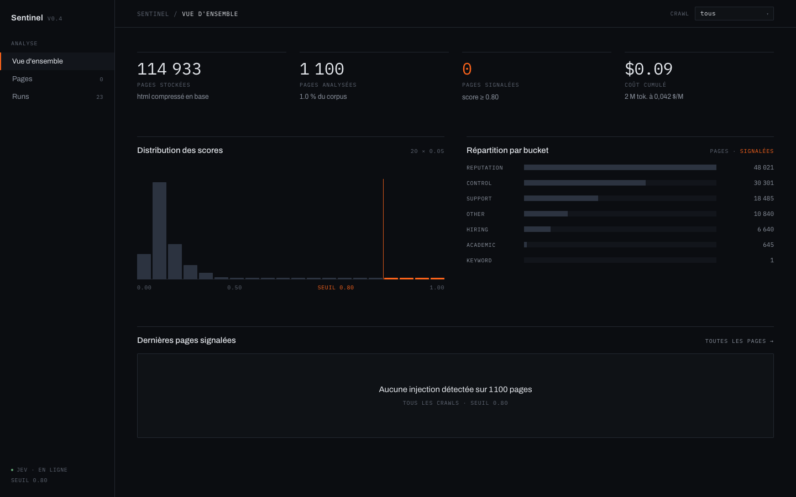

# Sentinel

Sentinel is a small POC that looks for indirect prompt injections in web pages: text hidden in a page, a comment, an attribute or an HTTP header, meant to be read by an AI agent, not by a human.

I started from the document [Indirect Prompt Injection in the Wild](https://arxiv.org/abs/2604.27202). I wanted to find the study's numbers again with my own code. On English pages, Sentinel doesn't bring anything new: it's a way to check that the project works in order torun the same analysis on other languages.

I didn't want to crawl the web by hand, so I used [Common Crawl](https://commoncrawl.org). It already provides billions of pages with their raw HTML and HTTP headers, and an index that lets me pick only the pages I want. 

For scoring, I used [Jev](https://docs.typesafe.ai/models). There's no need for a full LLM to decide whether a page contains an injection, and Jev is very cheap. It came out recently, which is also why I started this project. Sentinel extracts every channel an agent could read based on the arxiv document and asks Jev for a score.

Jev did well: 1,100 pages scored for **$0.09** in total, about 0.7 s per page, and no false positive above the 0.8 threshold.

As soon as an open-source version of Jev comes out with the same performance (probably within 2 or 3 months), I'll keep going with a local model, and run much larger analyses.
